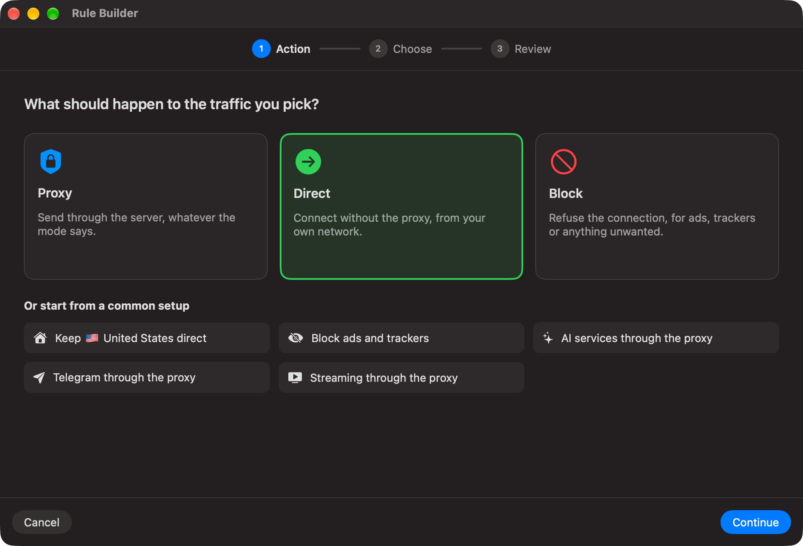
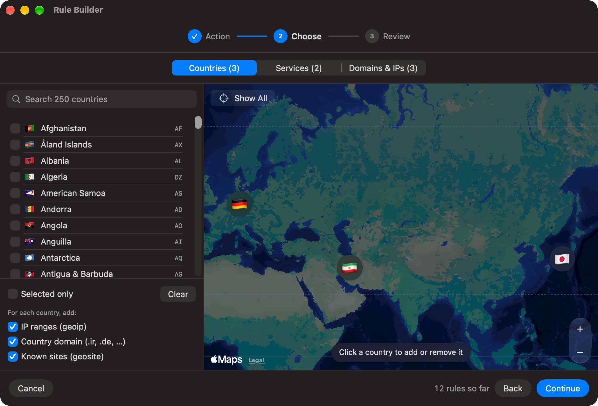
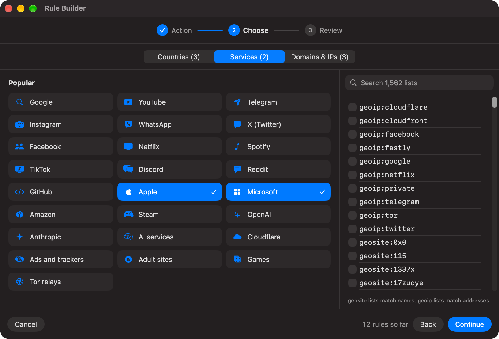
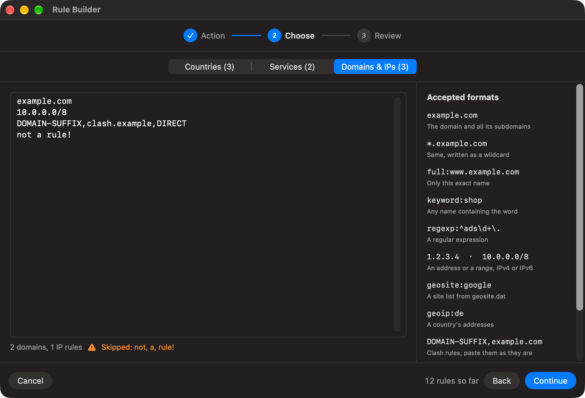
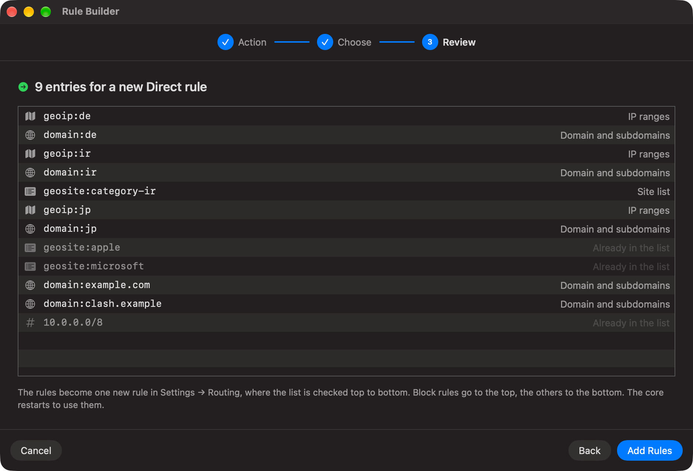

<p align="center"></p>

<p align="center"><a href="README.md">English</a> | فارسی | <a href="README.zh.md">简体中文</a></p>

<div dir="rtl">

# V2Mac

**کلاینت بومی macOS برای [Xray-core](https://github.com/XTLS/Xray-core).** لینک اشتراک را وارد کنید، یک سرور انتخاب کنید و یک پروکسی محلی SOCKS5 و HTTP تحویل بگیرید. با SwiftUI و Liquid Glass ساخته شده، برای مک‌های Apple Silicon.

## امکانات

- **اشتراک‌ها:** لینک‌های VLESS، VMess، Trojan، Shadowsocks، Hysteria2، WireGuard و SOCKS/HTTP ساده، و همچنین کانفیگ کامل JSON برای Xray را وارد می‌کند. به‌روزرسانی خودکار دارد و اگر سرویس‌دهنده اعلام کند، حجم مصرف‌شده و تاریخ انقضا را نشان می‌دهد.
- **افزودن و ویرایش دستی سرور:** همه‌ی جزئیات یک سرور VLESS، VMess، Trojan، Shadowsocks، Hysteria2، WireGuard، SOCKS یا HTTP را خودتان وارد کنید (ترنسپورت، TLS یا REALITY، Mux)، یا سروری را که وارد کرده‌اید تغییر دهید.
- **علاقه‌مندی‌ها:** سرورهای دلخواه را ستاره‌دار کنید تا در یک فهرست جدا باشند. به‌روزرسانی اشتراک هیچ‌وقت بدون پرسیدن آن‌ها را حذف نمی‌کند.
- **تست تأخیر:** تست Real Delay و TCP Ping برای کل یک گروه به‌صورت یک‌جا، مرتب‌شده بر اساس سرعت.
- **انتخاب خودکار اختیاری:** به‌صورت پیش‌فرض خاموش است؛ با تأخیر پاسخ واقعی HTTP سرور سالم را انتخاب می‌کند، پروکسی فعال را بررسی می‌کند و در صورت خرابی، سرورهای همان گروه را به‌ترتیب امتحان می‌کند. انتخاب دستی تا زمانی که پاسخ بدهد حفظ می‌شود.
- **مسیریابی:** حالت Global، حالت Direct، یا دور زدن منطقه‌ای (ایران، چین، روسیه) تا ترافیک داخلی مستقیم برود.
- **قوانین مسیریابی سفارشی:** فهرست‌های Proxy، Direct و Block خودتان، روی هر حالت مسیریابی. دامنه، رنج IP، تگ‌های geosite/geoip، قوانین Clash، فایل hosts یا فهرست‌های Adblock را بچسبانید، یا با **Rule Builder** کشورها را روی نقشه و سرویس‌ها را از فهرست انتخاب کنید. [توضیح کامل در پایین](#قوانین-مسیریابی-سفارشی).
- **حالت TUN:** با یک کلید، تمام ترافیک مک از پروکسی رد می‌شود؛ حتی برنامه‌هایی که تنظیم پروکسی ندارند و همه درخواست‌های DNS. نیازی به حساب پولی توسعه‌دهنده یا System Extension نیست. اسکریپت `Scripts/check-tun.sh` بررسی می‌کند که چیزی نشت نکند.
- **رفتار مشخص هنگام خرابی TUN:** انتخاب کنید پروکسی محلی روشن بماند یا اتصال متوقف شود. وضعیت پروکسی محلی از تونل فعال سیستم جدا نمایش داده می‌شود. این گزینه کلید قطع اضطراری سیستم نیست: وقتی تونل قطع است، ترافیک مستقیم ارسال می‌شود.
- **کنترل از نوار منو:** اتصال، تعویض سرور، سرعت لحظه‌ای و آدرس محلی که می‌شود کپی کرد.
- **پایدار:** بعد از کرش، خواب سیستم یا تغییر شبکه هسته را دوباره راه می‌اندازد و هنگام باز شدن برنامه دوباره وصل می‌شود.
- **و همچنین:** اشتراک‌گذاری روی شبکه محلی با رمز، کد QR، نمایش لاگ، اجرا هنگام ورود به سیستم، و به‌روزرسانی برنامه و هسته Xray با یک کلیک.
- **خصوصی:** بدون هیچ آمارگیری یا تله‌متری.

## تصاویر برنامه

تصاویر از نسخهٔ فعلی V2MacDev با سرورهای نمونه و ساختگی گرفته شده‌اند. پروکسی نسخهٔ توسعه از پورت `10818` استفاده می‌کند؛ پورت پیش‌فرض برنامهٔ نصب‌شده `10808` است.

**مرور سرورها:** مرتب‌سازی بر اساس تأخیر، باز کردن علاقه‌مندی‌ها و جست‌وجوی سرور.

<p align="center"></p>

<details>
<summary>تصاویر بیشتر: وارد کردن اشتراک، ویرایش، اشتراک‌گذاری QR و تنظیمات</summary>

<p align="center"></p>

پنجره اصلی هر اشتراک را با حجم مصرف‌شده و روزهای باقی‌مانده نشان می‌دهد، و کنار هر سرور تأخیر و بیشترین سرعت دانلود را. با انتخاب یک سرور، جزئیاتش را می‌بینید و می‌توانید لینک اشتراک یا کد QR آن را کپی کنید. نوار پایین، وضعیت اتصال، کلید TUN، حالت مسیریابی و آدرس پروکسی محلی را نشان می‌دهد.

**مرور تنظیمات:** عمومی، پروکسی، مسیریابی، اتصال، سرورها، اعلان‌ها، هسته و درباره.

<p align="center"></p>

انتخاب خودکار سرور به‌صورت پیش‌فرض خاموش است. تنظیمات اتصال، بررسی پاسخ واقعی HTTP را توضیح می‌دهد و اجازه می‌دهد رفتار برنامه هنگام خرابی TUN را انتخاب کنید.

<p align="center"></p>

**افزودن اشتراک** با آدرس و نام اختیاری.

<p align="center"></p>

**ویرایش کپی سرور** در تنظیمات سفارشی، بدون تغییر سرور اصلی اشتراک.

<p align="center"></p>

**اشتراک‌گذاری سرور** با کد QR در پنل جزئیات.

<p align="center"></p>

**تنظیمات عمومی** شامل اجرا، اتصال مجدد، بازیابی پس از خواب یا تغییر شبکه، به‌روزرسانی و عیب‌یابی است.

<p align="center"></p>

**تنظیمات پروکسی** برای پورت محلی و دسترسی اختیاری شبکهٔ محلی با احراز هویت است.

<p align="center"></p>

**تنظیمات مسیریابی** برای انتخاب حالت مسیریابی، مدیریت مناطق عبور مستقیم و [قوانین سفارشی](#قوانین-مسیریابی-سفارشی) است.

<p align="center"></p>

</details>

## نصب

به macOS 26 یا جدیدتر روی Apple Silicon نیاز دارد.

با [Homebrew](https://brew.sh) یک دستور برنامه را نصب می‌کند و هشدار Gatekeeper را هم برمی‌دارد، پس می‌توانید مستقیم به مرحله ۳ بروید:

```sh
brew install --cask lordversa/tap/v2mac
```

برای به‌روزرسانی بعدی `brew upgrade --cask v2mac` را اجرا کنید. یا دستی نصب کنید:

1. فایل `V2Mac-<version>.dmg` را از [Releases](../../releases) دانلود کنید و **V2Mac** را به پوشه **Applications** بکشید.
2. برنامه notarize نشده است، پس macOS اولین اجرا را مسدود می‌کند. یک بار آن را باز کنید، سپس به **System Settings → Privacy & Security** بروید و روی **Open Anyway** بزنید. یا این دستور را در Terminal اجرا کنید:

   ```sh
   xattr -dr com.apple.quarantine /Applications/V2Mac.app
   ```

3. روی **Add Subscription** بزنید، لینک خود را وارد کنید و برای اتصال روی یک سرور دوبار کلیک کنید.
4. برنامه‌هایتان را روی `socks5://127.0.0.1:10808` یا `http://127.0.0.1:10808` تنظیم کنید.

اگر می‌خواهید کل مک از پروکسی رد شود، کلید **TUN** را کنار منوی مسیریابی روشن کنید. macOS در هر بار باز شدن V2Mac یک بار رمز مدیر سیستم را می‌پرسد؛ چیزی روی سیستم نصب نمی‌شود.

بستن پنجره پروکسی را قطع نمی‌کند. برای توقف، با ⌘Q از برنامه خارج شوید.

## قوانین مسیریابی سفارشی

حالت مسیریابی تکلیف بیشتر ترافیک را روشن می‌کند. قوانین سفارشی استثناها را تعیین می‌کنند: کدام سایت‌ها، کشورها یا آدرس‌ها همیشه **از پروکسی** بروند، همیشه **مستقیم** بروند، یا **مسدود** شوند. این قوانین در همهٔ حالت‌ها و در کنار دور زدن منطقه‌ای کار می‌کنند؛ مثلاً می‌توانید ایران را مستقیم بفرستید ولی یک سایت ایرانی را همچنان از پروکسی رد کنید، یا در هر حالتی تبلیغات را مسدود کنید.

به **Settings → Routing → Custom rules** بروید. سه فهرست دارد: Proxy، Direct و Block، و در هر خط یک قانون. بعد از ویرایش روی **Apply** بزنید؛ اگر وصل باشید، اتصال برای اعمال قوانین دوباره راه‌اندازی می‌شود.

<p align="center"></p>

**ترتیب بررسی قوانین**

1. فهرست **Block**
2. فهرست **Proxy**
3. فهرست **Direct**
4. و بعد خود حالت مسیریابی: آدرس‌های شبکهٔ محلی مستقیم، بعد بسته‌های منطقه‌ای Bypass، و بقیه از پروکسی.

اولین قانونی که بخورد اعمال می‌شود؛ پس سایتی که در فهرست Proxy است از پروکسی می‌رود، حتی اگر کشورش دور زده شده باشد. در حالت **Direct** فقط فهرست Block استفاده می‌شود، چون در این حالت هیچ چیز نباید به پروکسی برسد. کانفیگ‌های کامل JSON مسیریابی خودشان را دارند و قوانین سفارشی روی آن‌ها اعمال نمی‌شود.

**چه چیزهایی می‌شود نوشت**

فهرست‌ها را با همان قالب‌هایی که در بیشتر آموزش‌ها و rule setهای اینترنت هست بچسبانید. کاما و فاصله هم قوانین را از هم جدا می‌کنند، و خطی که با `#`، `//` یا `!` شروع شود توضیح است.

| بنویسید | چه چیزی را می‌گیرد |
|---|---|
| `example.com`، `*.example.com`، `+.example.com`، `.ir` | خود دامنه و همهٔ زیردامنه‌هایش (`.ir` یعنی همهٔ سایت‌های `.ir`) |
| `full:www.example.com` | فقط همین نام دقیق |
| `keyword:shop` | هر نامی که این کلمه را داشته باشد |
| `regexp:^ads\d+\.` | نام‌هایی که با یک عبارت باقاعده جور باشند |
| `1.2.3.4`، `10.0.0.0/8`، `2001:db8::/32` | یک آدرس یا یک رنج، IPv4 یا IPv6 |
| `geosite:google`، `geosite:category-ads-all` | یک فهرست سایت از `geosite.dat` هسته (بیش از ۱۵۰۰ فهرست) |
| `geoip:de`، `geoip:telegram` | آدرس‌های یک کشور یا سرویس از `geoip.dat` |
| `ext:region-ir-geosite.dat:ir` | فهرستی از یک بستهٔ منطقه‌ای دانلودشده |
| `DOMAIN-SUFFIX,example.com,DIRECT` | قوانین Clash: `DOMAIN`، `DOMAIN-SUFFIX`، `DOMAIN-KEYWORD`، `DOMAIN-REGEX`، `IP-CIDR`، `IP-CIDR6`، `GEOIP`، `GEOSITE` (فهرستی که در آن می‌چسبانید عمل را تعیین می‌کند) |
| `0.0.0.0 ads.example.com` | خط‌های فایل hosts |
| `\|\|ads.example.com^` | خط‌های دامنهٔ Adblock |

هر چیزی که قانون نباشد نادیده گرفته می‌شود و زیر ویرایشگر نامش می‌آید، پس یک غلط تایپی هیچ‌وقت اتصال را خراب نمی‌کند.

### Rule Builder

نمی‌خواهید قانون تایپ کنید؟ روی **Rule Builder…** زیر فهرست‌ها بزنید. در سه مرحله قوانین را برایتان می‌نویسد.

**۱. عمل (Action).** انتخاب کنید چه اتفاقی بیفتد: Proxy، Direct یا Block. یا از یک تنظیم آماده شروع کنید؛ مثل مستقیم نگه داشتن کشور خودتان، مسدود کردن تبلیغات و ردیاب‌ها، یا فرستادن سرویس‌های هوش مصنوعی، تلگرام یا استریم از پروکسی.

<p align="center"></p>

**۲. انتخاب (Choose).** از سه زبانه انتخاب کنید چه چیزی گرفته شود. عددهای روی زبانه‌ها و پایین پنجره نشان می‌دهند تا الان چه مقدار انتخاب کرده‌اید.

- **کشورها (Countries):** بین همهٔ ۲۵۰ کشور با نام یا کد جست‌وجو کنید، یا روی کشوری در نقشه کلیک کنید تا اضافه یا حذف شود. هر کشور انتخاب‌شده یک پرچم روی نقشه می‌گیرد. برای هر کشور انتخاب می‌کنید چه چیزی اضافه شود: رنج‌های IP آن (`geoip:ir`)، پسوند دامنه‌اش (`domain:ir`، یعنی همهٔ سایت‌های `.ir`)، و فهرست سایت‌های شناخته‌شده‌اش روی دامنه‌های دیگر (`geosite:category-ir`) اگر فایل‌های قوانین آن را داشته باشند.

<p align="center"></p>

- **سرویس‌ها (Services):** با یک کلیک Google، YouTube، تلگرام، اینستاگرام، واتس‌اپ، X، Netflix، Spotify، OpenAI، Anthropic، Apple، Microsoft، تبلیغات و ردیاب‌ها و موارد دیگر. در سمت راست می‌توانید در همهٔ فهرست‌های فایل‌های قوانین هسته جست‌وجو کنید. این فهرست‌ها از خود فایل‌ها خوانده می‌شوند، پس Rule Builder هیچ‌وقت قانونی برای فهرستی که هسته ندارد نمی‌نویسد.

<p align="center"></p>

- **دامنه و IP (Domains & IPs):** هر چیزی با قالب‌های بالا را تایپ کنید یا بچسبانید. همان لحظه بررسی می‌شود و راهنمای قالب‌ها کنارش هست.

<p align="center"></p>

**۳. بازبینی (Review).** همهٔ قوانینی که نوشته می‌شوند و نوع هر کدام را می‌بینید. قوانینی که از قبل در فهرست هستند علامت می‌خورند و دوباره اضافه نمی‌شوند. **Add to the list** (افزودن) یا **Replace the list** (جایگزینی) را انتخاب کنید و روی **Add Rules** بزنید. قوانین زیر یک توضیح تاریخ‌دار `# Rule Builder` ذخیره می‌شوند تا بعداً در تنظیمات پیدا و ویرایششان کنید.

<p align="center"></p>

**چند مثال**

| هدف | فهرست | قوانین |
|---|---|---|
| مسدود کردن تبلیغات همه‌جا | Block | `geosite:category-ads-all` |
| سرویس‌های هوش مصنوعی از پروکسی، حتی با دور زدن ایران | Proxy | `geosite:openai`، `geosite:anthropic`، `geosite:category-ai-!cn` |
| به‌روزرسانی‌های Apple و Microsoft بدون پروکسی | Direct | `geosite:apple`، `geosite:microsoft` |
| دسترسی مستقیم به شبکهٔ محل کار | Direct | `10.0.0.0/8`، `full:intranet.example.com` |
| استفاده از یک فهرست قوانین Clash دانلودشده | هر کدام | خط‌های `payload:` را همان‌طور که هست بچسبانید |

قانونی که اسم فهرستی را بیاورد که در فایل‌ها نیست، مثلاً `geosite:nonexistent`، باعث می‌شود هسته اجرا نشود؛ لاگ می‌گوید کدام. Rule Builder فقط فهرست‌هایی را پیشنهاد می‌دهد که وجود دارند.

## جلوگیری از نشت اطلاعات در کروم: noleaker

پروکسی به‌تنهایی جلوی لو رفتن شما توسط مرورگر را نمی‌گیرد: WebRTC می‌تواند IP واقعی‌تان را نشان بدهد، DNS و QUIC ممکن است پروکسی را دور بزنند، و منطقه زمانی و زبان مرورگر همچنان نشان می‌دهند کجا هستید. برای کروم و مرورگرهای مبتنی بر Chromium از [**noleaker**](https://github.com/LordVersA/noleaker) استفاده کنید؛ یک افزونه رایگان و متن‌باز از همین سازنده که در کنار V2Mac کار می‌کند:

- تمام ترافیک مرورگر و درخواست‌های DNS را از پروکسی SOCKS5 برنامه V2Mac رد می‌کند و جلوی نشت WebRTC و QUIC را می‌گیرد.
- منطقه زمانی، زبان و موقعیت جغرافیایی را با کشور سرور شما هماهنگ می‌کند.
- کلید قطع اضطراری (Kill Switch): اگر پروکسی قطع شود، درخواست‌ها مسدود می‌شوند و مستقیم بیرون نمی‌روند.
- تست نشت داخلی که تک‌تک این موارد را بررسی می‌کند و می‌گوید کدام تنظیم مشکل را حل می‌کند.
- در حالت Compatibility سایت‌های داخلی ایران بدون پروکسی باز می‌شوند.

راه‌اندازی: noleaker را از [آخرین نسخه](https://github.com/LordVersA/noleaker/releases/latest) نصب کنید، یک پروکسی با هاست `127.0.0.1` و پورت `10808` اضافه کنید و **Protection** را روشن کنید. noleaker نمی‌تواند نام کاربری و رمز پروکسی بفرستد، پس این دو را در تنظیمات V2Mac خالی بگذارید. روی Chrome 120 و جدیدتر تست شده است.

## ساخت از سورس

```sh
Scripts/fetch-core.sh
xcodegen generate
xcodebuild -project v2mac.xcodeproj -scheme v2mac -configuration Debug build
```

به Xcode 26 یا جدیدتر و [XcodeGen](https://github.com/yonaskolb/XcodeGen) نیاز دارد. طراحی برنامه در [docs/SPEC.md](docs/SPEC.md) آمده است (به انگلیسی).

## مجوز

GPL-3.0. فایل‌های [LICENSE](LICENSE) و [THIRD_PARTY.md](THIRD_PARTY.md) را ببینید.

</div>
