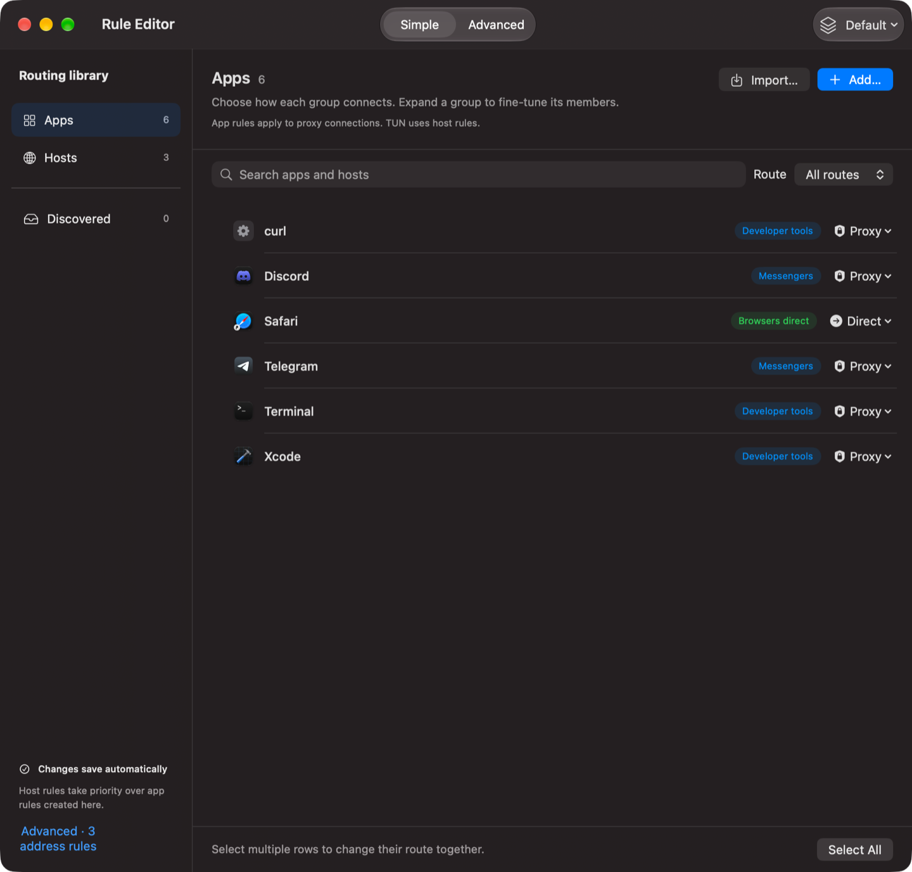
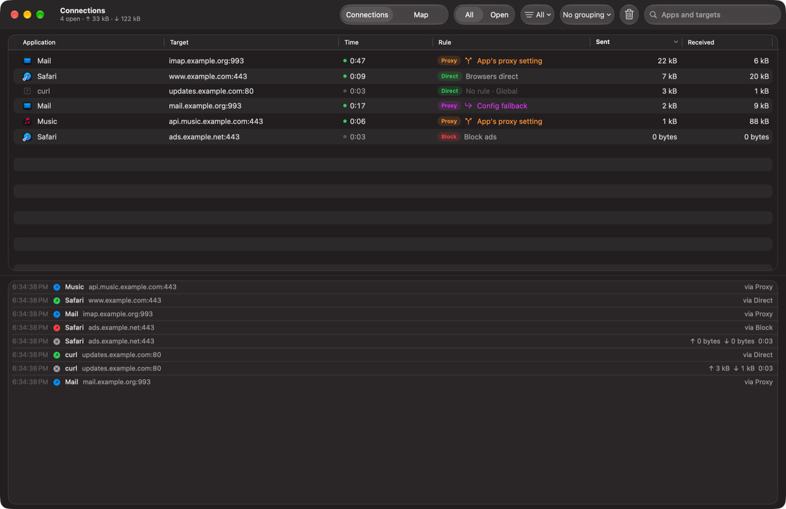
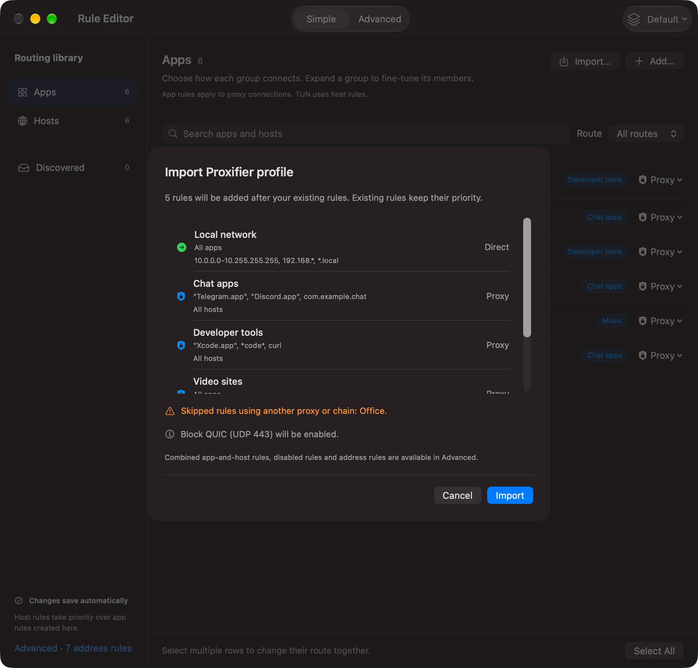

<p align="center"></p>

<h1 align="center">V2Mac</h1>

<p align="center"><b>A native macOS client for Xray-core and V2Ray.</b><br>
VLESS, REALITY, VMess, Trojan, Shadowsocks, Hysteria2 and WireGuard in a fast SwiftUI menu bar app for Apple Silicon.</p>

<p align="center">
  <a href="https://github.com/LordVersA/v2mac/releases/latest"></a>
  <a href="https://github.com/LordVersA/v2mac/releases"></a>
  <a href="https://github.com/LordVersA/v2mac/actions/workflows/ci.yml"></a>
  
  
  
  <a href="LICENSE"></a>
  <a href="https://github.com/LordVersA/v2mac/stargazers"></a>
</p>

<p align="center">English | <a href="README.fa.md">فارسی</a> | <a href="README.zh.md">简体中文</a> | <a href="README.ru.md">Русский</a></p>

<p align="center">
  <a href="#install">Install</a> ·
  <a href="#features">Features</a> ·
  <a href="https://github.com/LordVersA/v2mac/wiki"><b>Documentation</b></a> ·
  <a href="#build-from-source">Build</a>
</p>

<p align="center"></p>

Paste a subscription link, pick a server, and you have a local SOCKS5 + HTTP proxy, or turn on TUN mode to send the whole Mac through it. V2Mac is a free, open-source **v2rayN / V2RayX alternative for macOS**, written natively in SwiftUI with Liquid Glass. No Electron, no analytics, no telemetry.

## Install

Requires **macOS 26 or later** on **Apple Silicon**.

```sh
brew install --cask lordversa/tap/v2mac
```

Or download the DMG from the [latest release](https://github.com/LordVersA/v2mac/releases/latest). It is not notarized: on first launch use **Open Anyway** in System Settings → Privacy & Security. Details in the [installation guide](https://github.com/LordVersA/v2mac/wiki/Installation).

**Quick start:** click **Add Subscription** and paste your link, double-click a server, then use `127.0.0.1:10808` (SOCKS5 / HTTP) or switch on **System Proxy** or **TUN**.

## Features

- **Protocols:** VLESS (REALITY, XTLS Vision), VMess, Trojan, Shadowsocks, Hysteria2, WireGuard, SOCKS, HTTP and full Xray JSON configs.
- **Subscriptions:** auto-update, usage and expiry, favorites, QR and one-click import, a full server editor.
- **Connection:** real-delay and speed tests, automatic server selection, live switching without a restart, exit country in the menu bar.
- **Whole-Mac modes:** TUN, system proxy and a pf-based kill switch.
- **Routing:** Global, Bypass regions (Iran, China, Russia), Rules Only and Direct, plus Proxy / Direct / Block rules by site and by app.
- **Proxifier alternative:** per-app rules, `.ppx` profile import, a visual Rule Builder and a live Connections view.
- **Cloudflare WARP:** as its own server or chained behind yours.
- **macOS:** menu bar panel, Shortcuts, Siri, Spotlight, Control Center, a desktop widget, Apple Intelligence domain suggestions, Touch ID, notifications, backup and restore. English, Persian, Chinese and Russian.

## Screenshots

<p align="center"></p>

<table>
  <tr>
    <td align="center"><br><sub>Per-app and per-site rules</sub></td>
    <td align="center"><br><sub>Every connection and the rule behind it</sub></td>
  </tr>
  <tr>
    <td align="center"><br><sub>Rule Builder</sub></td>
    <td align="center"><br><sub>Proxifier import</sub></td>
  </tr>
</table>

## Documentation

The **[V2Mac Wiki](https://github.com/LordVersA/v2mac/wiki)** covers everything in detail:

| | |
|---|---|
| [Installation](https://github.com/LordVersA/v2mac/wiki/Installation) | Homebrew, DMG, first launch, updates |
| [Servers and Subscriptions](https://github.com/LordVersA/v2mac/wiki/Servers-and-Subscriptions) | Adding, updating, editing, latency tests |
| [Connecting](https://github.com/LordVersA/v2mac/wiki/Connecting) | TUN, system proxy, kill switch, exit check, WARP |
| [Routing](https://github.com/LordVersA/v2mac/wiki/Routing) | Modes, custom rules, Proxifier import, Rule Builder |
| [Connections](https://github.com/LordVersA/v2mac/wiki/Connections) | Live connection list and map |
| [Menu Bar and Shortcuts](https://github.com/LordVersA/v2mac/wiki/Menu-Bar-and-Shortcuts) | Panel, keyboard, Shortcuts, notifications |
| [Settings Reference](https://github.com/LordVersA/v2mac/wiki/Settings-Reference) | Every setting, backup, privacy |
| [Troubleshooting and FAQ](https://github.com/LordVersA/v2mac/wiki/Troubleshooting-and-FAQ) | Common problems and questions |

For leak protection in Chrome, pair V2Mac with [**noleaker**](https://github.com/LordVersA/noleaker), a free extension from the same author.

## Build from source

```sh
Scripts/fetch-core.sh
xcodegen generate
xcodebuild -project v2mac.xcodeproj -scheme v2mac -configuration Debug build
```

Needs Xcode 26+ and [XcodeGen](https://github.com/yonaskolb/XcodeGen). Design: [docs/SPEC.md](docs/SPEC.md). Tests: `cd Packages/V2MacCore && swift test`. Bug reports and pull requests are welcome in [Issues](https://github.com/LordVersA/v2mac/issues).

## License

[GPL-3.0](LICENSE). Bundles [Xray-core](https://github.com/XTLS/Xray-core) (MPL-2.0); see [THIRD_PARTY.md](THIRD_PARTY.md).

<p align="center"><sub>If V2Mac helps you, a ⭐ helps others find it.</sub></p>
