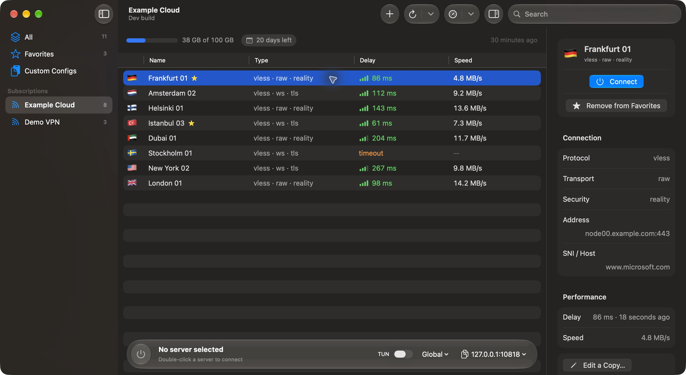
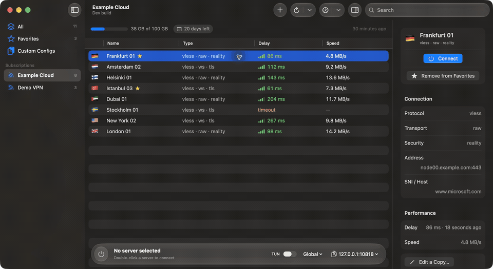
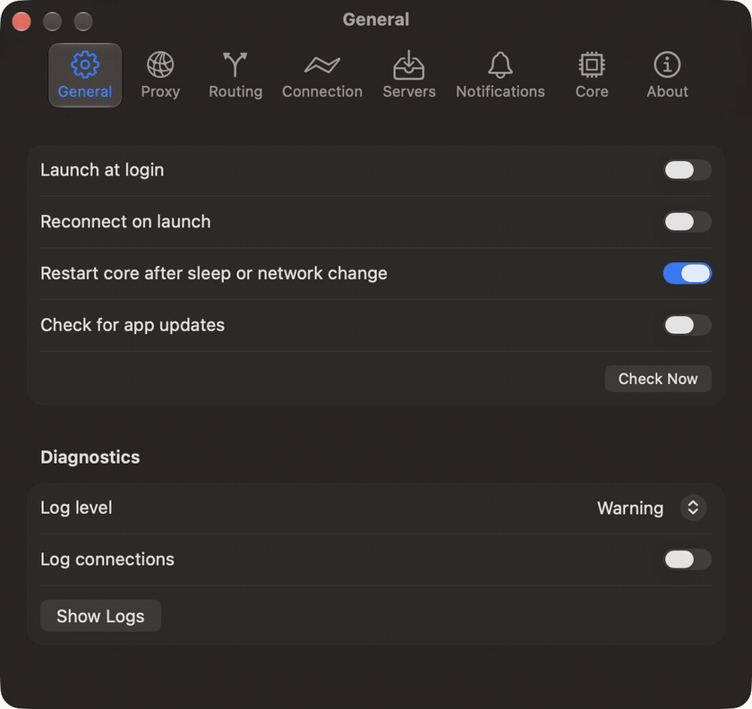
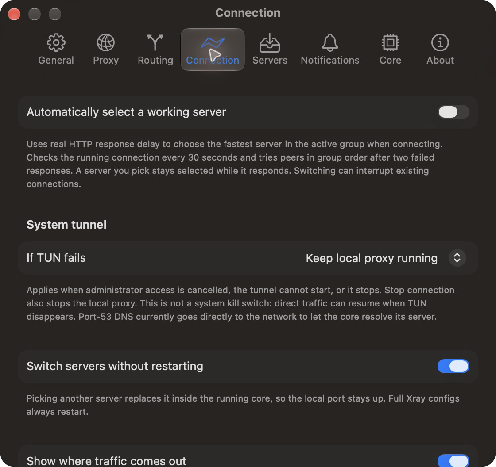
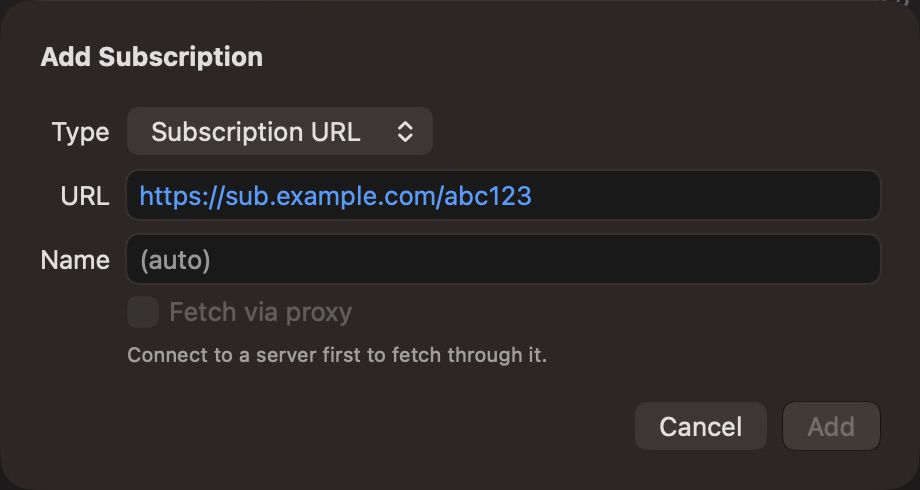
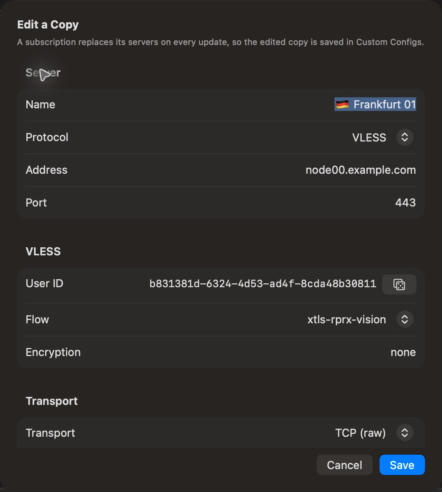
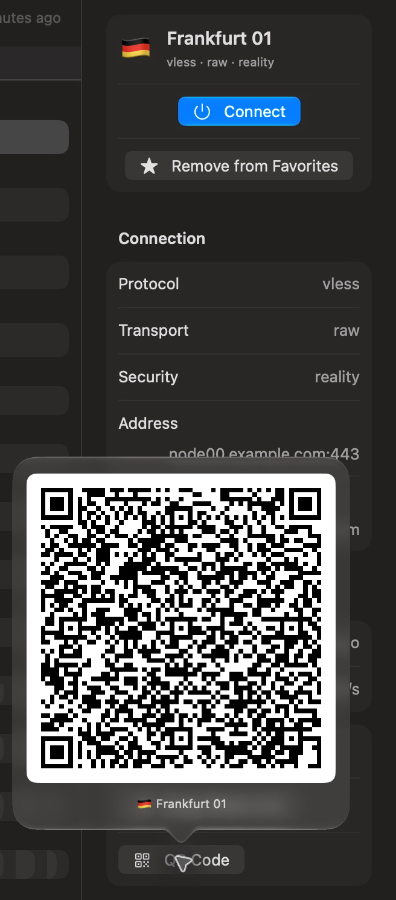
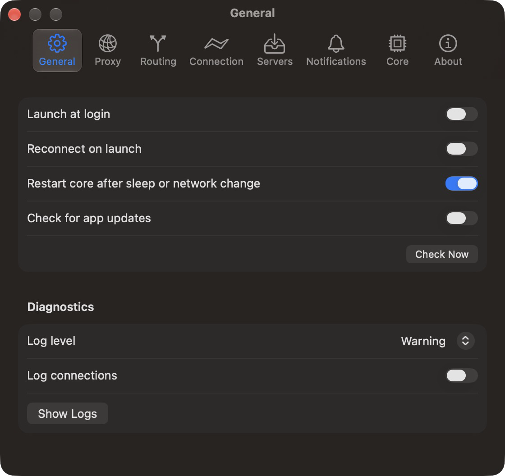
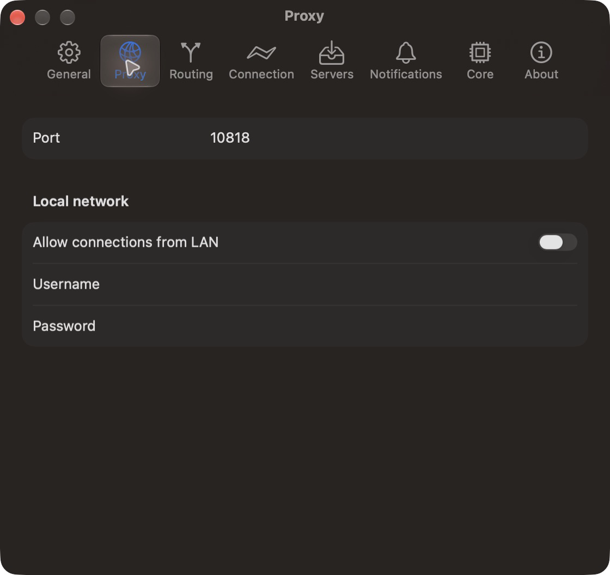
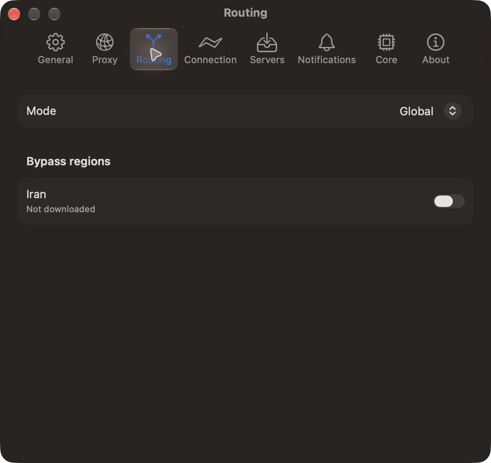

<p align="center"></p>

<p align="center"><a href="README.md">English</a> | <a href="README.fa.md">فارسی</a> | 简体中文</p>

# V2Mac

**[Xray-core](https://github.com/XTLS/Xray-core) 的原生 macOS 客户端。** 粘贴订阅链接，选择服务器，即可使用本地 SOCKS5 和 HTTP 代理。采用 SwiftUI 和 Liquid Glass 构建，专为 Apple Silicon Mac 设计。

## 功能

- **订阅：** 支持导入 VLESS、VMess、Trojan、Shadowsocks、Hysteria2、WireGuard、普通 SOCKS/HTTP 链接，以及完整的 Xray JSON 配置。支持自动更新；服务商提供相关信息时，可显示流量用量和到期时间。
- **手动添加和编辑服务器：** 手动填写 VLESS、VMess、Trojan、Shadowsocks、Hysteria2、WireGuard、SOCKS 或 HTTP 服务器的各项参数，包括传输方式、TLS 或 REALITY、Mux，也可以修改已导入的服务器。
- **收藏：** 将喜欢的服务器标记为收藏，并在同一个列表中查看。订阅更新时，删除收藏的服务器前会先征求确认。
- **延迟测试：** 批量测试整个分组的真实延迟（Real Delay）和 TCP Ping，并按速度排序。
- **可选的自动选择：** 默认关闭。根据真实 HTTP 响应延迟选择可用服务器，检查正在运行的代理，并在故障时按分组顺序切换到其他服务器。手动选择的服务器只要仍能响应，就会保持选中。
- **路由：** 支持全局（Global）、直连（Direct）和绕过地区（Bypass regions，包含伊朗）模式，让指定地区的流量直连。
- **TUN 模式：** 通过一个开关，将 Mac 上的所有流量转发到代理，包括没有代理设置的应用。无需付费开发者账号或系统扩展。
- **明确的 TUN 故障处理：** TUN 出现故障时，可选择继续运行本地代理或停止连接。状态显示会区分本地代理和已启用的系统隧道。这不是系统级断网保护；53 端口的 DNS 请求仍会直接发往网络。
- **菜单栏控制：** 连接、切换服务器、查看实时速度，以及复制本地代理地址。
- **可靠连接：** 核心崩溃、系统睡眠或网络变化后会重新启动核心，并在应用启动时重新连接。
- **其他功能：** 带密码的局域网共享、二维码、日志查看器、登录时启动，以及一键更新应用和 Xray 核心。
- **隐私：** 不收集使用统计或遥测数据。

## 截图

截图来自当前 V2MacDev 构建，使用虚构的演示服务器。开发版代理使用端口 `10818`；安装版应用的默认端口为 `10808`。

<p align="center"></p>

主窗口会显示每个订阅的流量用量和剩余天数，以及每台服务器的延迟和最高下载速度。选择服务器即可查看详情，并复制分享链接或二维码。底部栏显示连接状态、TUN 开关、路由模式和本地代理地址。

**浏览服务器：** 按延迟排序、打开收藏夹，并搜索服务器。

<p align="center"></p>

**设置导览：** 通用、代理、路由、连接、服务器、通知、核心和关于。

<p align="center"></p>

自动选择服务器默认关闭。连接设置说明了真实 HTTP 响应检查，并可选择 TUN 失败时的处理方式。

<p align="center"></p>

<details>
<summary>更多截图：导入、编辑、二维码分享和设置</summary>

**添加订阅：** 输入订阅地址和可选名称。

<p align="center"></p>

**编辑服务器副本：** 保存到自定义配置，不更改订阅中的原始条目。

<p align="center"></p>

**分享服务器：** 使用详情面板中的二维码。

<p align="center"></p>

**通用设置：** 启动、重新连接、睡眠或网络变化后的恢复、更新和诊断。

<p align="center"></p>

**代理设置：** 配置本地端口，以及带身份验证的可选局域网访问。

<p align="center"></p>

**路由设置：** 选择路由模式并管理绕过代理的地区。

<p align="center"></p>

</details>

## 安装

需要搭载 Apple Silicon 的 Mac，运行 macOS 26 或更高版本。

1. 从 [Releases](../../releases) 下载 `V2Mac-<version>.dmg`，将 **V2Mac** 拖入 **Applications（应用程序）** 文件夹。
2. 应用尚未通过 Apple 公证，因此 macOS 会阻止首次启动。先尝试打开一次，然后前往 **系统设置 → 隐私与安全性**，点击 **仍要打开**。也可以运行：

   ```sh
   xattr -dr com.apple.quarantine /Applications/V2Mac.app
   ```

3. 点击 **Add Subscription**，粘贴订阅链接，双击服务器即可连接。
4. 将应用的代理地址设置为 `socks5://127.0.0.1:10808` 或 `http://127.0.0.1:10808`。

如果希望整个 Mac 使用代理，请打开路由菜单旁的 **TUN** 开关。每次打开 V2Mac 后，macOS 会在首次启用 TUN 时要求输入一次管理员密码；不会安装任何组件。

关闭窗口后，代理仍会继续运行。使用 ⌘Q 退出应用即可停止代理。

## Chrome 防泄漏：noleaker

仅使用代理无法阻止浏览器泄露信息：WebRTC 可能暴露真实 IP，DNS 和 QUIC 可能绕过代理，时区和语言也可能透露所在地区。对于 Chrome 和其他基于 Chromium 的浏览器，可以使用 [**noleaker**](https://github.com/LordVersA/noleaker)。这是同一作者开发的免费开源扩展，可与 V2Mac 配合使用：

- 将所有浏览器流量和 DNS 查询通过 V2Mac 的 SOCKS5 代理发送，并阻止 WebRTC 和 QUIC 泄漏。
- 根据服务器所在国家或地区调整时区、语言和地理位置。
- 断网保护（Kill Switch）：代理断开时阻止请求，避免请求改为直连。
- 内置泄漏测试，逐项检查并说明需要调整哪些设置。
- 兼容模式允许托管在伊朗的网站绕过代理。

配置方法：从 [最新版本](https://github.com/LordVersA/noleaker/releases/latest) 安装 noleaker，添加主机为 `127.0.0.1`、端口为 `10808` 的代理，并开启 **Protection**。noleaker 无法发送代理用户名或密码，因此请在 V2Mac 设置中将这两项留空。已在 Chrome 120 及更新版本上测试。

## 从源码构建

```sh
Scripts/fetch-core.sh
xcodegen generate
xcodebuild -project v2mac.xcodeproj -scheme v2mac -configuration Debug build
```

需要 Xcode 26 或更高版本，以及 [XcodeGen](https://github.com/yonaskolb/XcodeGen)。设计规范见 [docs/SPEC.md](docs/SPEC.md)（英文）。

## 许可证

GPL-3.0。详见 [LICENSE](LICENSE) 和 [THIRD_PARTY.md](THIRD_PARTY.md)。
