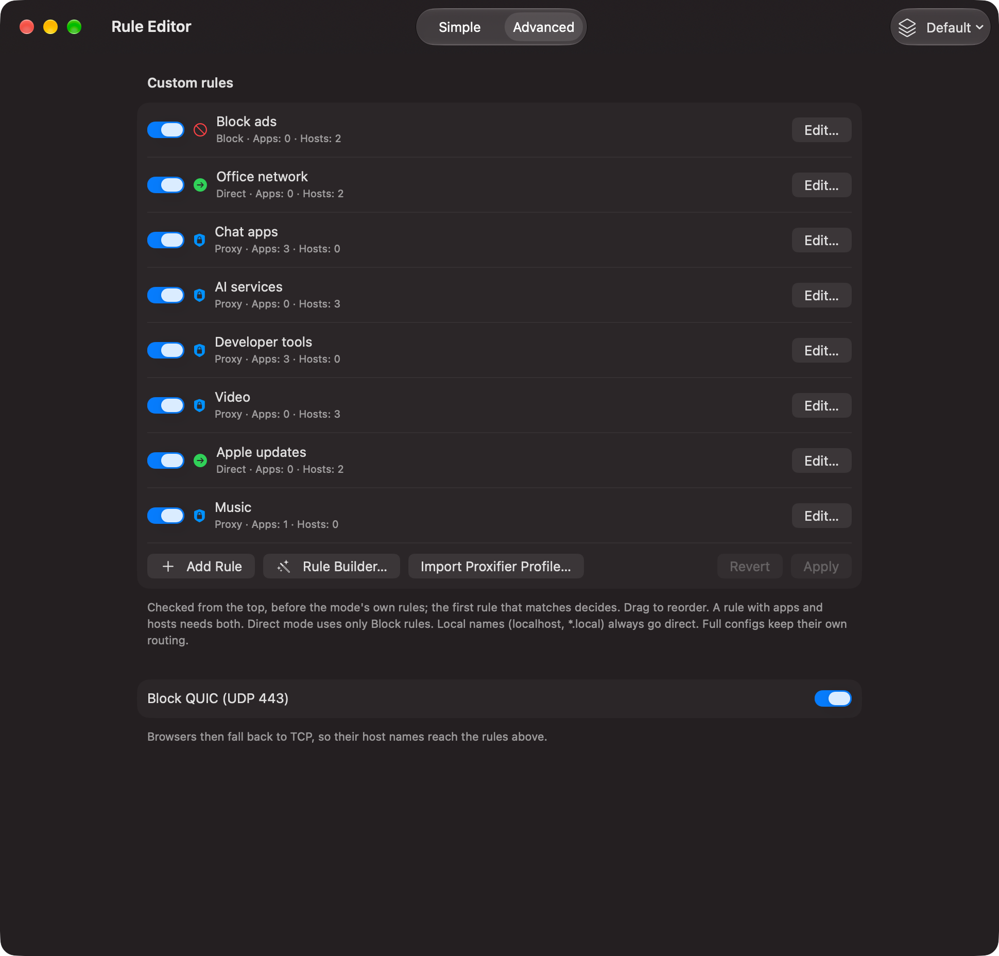

# V2Mac: Свои правила маршрутизации

Режим маршрутизации решает, что происходит с большей частью трафика. Свои правила задают исключения: какие сайты, страны или адреса всегда идут **через прокси**, всегда **напрямую** или **блокируются**. Они работают в любом режиме и вместе с обходом регионов, так что можно, например, обходить Иран, но пускать один иранский сайт через прокси или блокировать рекламу в любом режиме.

### Редактор правил

Откройте **Rule Editor** стеклянной кнопкой внизу боковой панели или кнопкой **Open Rule Editor…** в **Settings → Routing**. Вверху переключаются два вида, справа — меню профилей правил (держите несколько именованных наборов, например дом и работа, и переключайтесь между ними).

**Simple** — для повседневной работы. **Apps** и **Hosts** показывают каждое приложение или сайт, которые направляют ваши правила, по строке на каждый, с меню Proxy / Direct / Block; метка показывает, к какому правилу он относится. Связанные приложения (несколько помощников Xcode или VS Code) собираются в раскрывающуюся группу. **Discovered** собирает приложения и хосты из трафика, для которых ещё нет правила, чтобы направить их одним щелчком. Выделите несколько строк для массового изменения, фильтруйте по маршруту и используйте **Add…**, чтобы выбрать установленные приложения или ввести домены. Изменения сохраняются и применяются сами.

**Advanced** показывает весь упорядоченный список. У каждого правила есть переключатель, действие, приложения и хосты. **Add Rule** или **Edit…** открывает правило, порядок меняется перетаскиванием, **Apply** сохраняет (работающее подключение перезапускается). Отсюда же открываются **Rule Builder** и **Import Proxifier Profile…** и включается **Block QUIC (UDP 443)**. Диапазоны адресов и правила, сочетающие приложения и хосты, редактируются здесь.

Правило с приложениями и хостами срабатывает, только если совпали оба; пустое поле совпадает со всем. Правила работают в любом режиме: в режиме **Rules Only** на сервер идут только правила Proxy, а **Settings → Routing → Traffic that matches no rule** решает, куда идёт остальное (по режиму, Proxy, Direct или Block).

### Импорт из Proxifier

Переходите с Proxifier? Нажмите **Import…** в виде Simple (или **Import Proxifier Profile…** в Advanced) и выберите файл `.ppx`. Ничего не добавляется до подтверждения: окно проверки показывает каждое правило с приложениями, хостами и действием.

- Правила, ведущие на прокси на этом Mac (порт V2Mac), становятся правилами **Proxy**.
- Правила **Direct** и **Block** остаются как есть; выключенные правила импортируются выключенными.
- Правила через другой прокси или цепочку пропускаются и перечисляются оранжевым.
- Опция Proxifier **Block UDP 443** включает **Block QUIC**.
- Импортированные правила встают после ваших, так что ваши правила сохраняют приоритет.

### Приложения

Приложения можно указывать как `Spotify.app`, `com.spotify.client`, `*discord*`, имя процесса (`curl`) или полный путь. Правила для приложений работают для приложений, использующих системный прокси или подключающихся напрямую к порту прокси V2Mac. Соединения TUN пропускают правила для приложений, так как forwarder теряет сведения о приложении; правила по хостам/IP и маршрут по умолчанию действуют. То же относится к правилам процессов в импортированных JSON-конфигах.

Когда **System Proxy выключен**, приложения, настроенные на порт прокси V2Mac, пропускают свои и региональные правила и идут через сервер. Connections отмечает их оранжевым **App's proxy setting** и не добавляет в Discovered. Локальный трафик остаётся прямым, Block QUIC действует, а режим Direct по-прежнему применяет только правила Block, прежде чем отправить остальное напрямую. Когда **System Proxy включён**, весь трафик через этот порт следует правилам, поскольку ручные и системные подключения используют один порт. Полные JSON-конфиги следуют той же политике.

В **Connections** каждая строка показывает правило, которое её направило, а правый щелчок открывает это правило. **By Host** и **By Application** собирают трафик в раскрывающиеся группы, как в редакторе правил.

**Порядок проверки правил**

1. Блокировка QUIC, если включена; затем локальные имена (`localhost`, `*.local`, `*.test`, …) и адреса локальной сети идут напрямую.
2. Описанное выше исключение для прокси приложения, затем ваши правила сверху вниз.
3. Затем сам режим маршрутизации: пакеты обхода регионов, затем всё остальное через прокси (или напрямую в режиме Direct).

Срабатывает первое совпадение, поэтому сайт из правила Прокси идёт через прокси, даже если его страна в обходе, а правило Напрямую выше широкого правила Прокси побеждает его. В режиме **Напрямую** используются только правила Блокировать, потому что в этом режиме ничего не должно попадать в прокси. Полные JSON-конфигурации Xray сначала используют правила и режим V2Mac, а затем импортированную маршрутизацию как резервную. Для них также доступен выбор режима. В окне подключений резервный маршрут отмечен фиолетовым как **Резервная маршрутизация конфигурации**, а ручной прокси остаётся оранжевым. IP-правила разрешают имена при проверке, чтобы более позднее общее правило не срабатывало раньше них.

**Что можно писать**

Хосты правила принимают форматы, которые используют большинство инструкций, наборов правил и Proxifier. Записи также разделяются запятыми, пробелами и `;`, а строки, начинающиеся с `#`, `//` или `!`, считаются комментариями.

| Запись | Совпадает с |
|---|---|
| `example.com`, `*.example.com`, `+.example.com`, `.ir` | доменом и всеми его поддоменами (`.ir` охватывает все сайты в `.ir`) |
| `full:www.example.com` | только этим точным именем |
| `keyword:shop`, `*shop*` | любым именем, содержащим это слово |
| `regexp:^ads\d+\.` | именами, подходящими под регулярное выражение |
| `1.2.3.4`, `10.0.0.0/8`, `2001:db8::/32`, `10.0.0.1-10.0.0.9` | адресом или диапазоном, IPv4 или IPv6 |
| `geosite:google`, `geosite:category-ads-all` | списком сайтов из `geosite.dat` ядра (более 1500 списков) |
| `geoip:de`, `geoip:telegram` | адресами страны или сервиса из `geoip.dat` |
| `ext:region-ir-geosite.dat:ir` | списком из скачанного пакета региона |
| `DOMAIN-SUFFIX,example.com,DIRECT` | правилами Clash: `DOMAIN`, `DOMAIN-SUFFIX`, `DOMAIN-KEYWORD`, `DOMAIN-REGEX`, `IP-CIDR`, `IP-CIDR6`, `GEOIP`, `GEOSITE` (действие определяет правило, а не столбец policy) |
| `0.0.0.0 ads.example.com` | строками из файла hosts |
| `\|\|ads.example.com^` | доменными строками Adblock |

Всё, что не является правилом, пропускается и указывается под редактором, так что опечатка никогда не помешает подключению.

### Конструктор правил

Не хочется набирать правила? Нажмите **Rule Builder…** в виде Advanced редактора правил. Он составит их за вас в три шага.

**1. Действие.** Выберите, что должно происходить: Прокси, Напрямую или Блокировать. Или начните с готового варианта: оставить свою страну напрямую, блокировать рекламу и трекеры, пустить сервисы ИИ, Telegram или стриминг через прокси.

**2. Выбор.** Выберите, с чем сопоставлять, на одной из трёх вкладок. Счётчики на вкладках и внизу окна показывают, сколько уже выбрано.

- **Страны:** ищите среди всех 250 стран по названию или коду или щёлкните страну на карте, чтобы добавить или убрать её. На каждой выбранной стране на карте появляется флаг. Для каждой страны вы выбираете, что добавить: её диапазоны IP (`geoip:ir`), её доменную зону (`domain:ir`, все сайты в `.ir`) и её список известных сайтов на других доменах (`geosite:category-ir`), если такой есть в файлах правил.

- **Сервисы:** в один клик Google, YouTube, Telegram, Instagram, WhatsApp, X, Netflix, Spotify, OpenAI, Anthropic, Apple, Microsoft, реклама и трекеры и многое другое. Справа можно искать по всем спискам в файлах правил ядра. Списки берутся из самих файлов, поэтому конструктор никогда не напишет правило для списка, которого нет в ядре.

- **Домены и IP:** введите или вставьте что угодно в форматах выше. Ввод проверяется на лету, а рядом есть подсказка по форматам.

**3. Проверка.** Посмотрите все записи, которые будут добавлены, и их тип. Записи, которые уже есть в правилах с тем же действием, отмечены и не добавляются повторно. Нажмите **Добавить правила**, и они сохранятся как одно новое правило с датой в имени: правило Блокировать встаёт в начало списка, остальные в конец. Потом его можно переименовать, изменить или переместить в настройках.

**Примеры**

| Цель | Список | Правила |
|---|---|---|
| Блокировать рекламу везде | Блокировать | `geosite:category-ads-all` |
| Сервисы ИИ через прокси, даже при обходе Ирана | Прокси | `geosite:openai`, `geosite:anthropic`, `geosite:category-ai-!cn` |
| Обновления Apple и Microsoft мимо прокси | Напрямую | `geosite:apple`, `geosite:microsoft` |
| Прямой доступ к офисной сети | Напрямую | `10.0.0.0/8`, `full:intranet.example.com` |
| Скачанный список правил Clash | любой | вставьте строки `payload:` как есть |

Правило со списком, которого нет в файлах (например, `geosite:nonexistent`), не даст ядру запуститься; в журнале будет сказано, какой именно. Конструктор правил предлагает только существующие списки.

